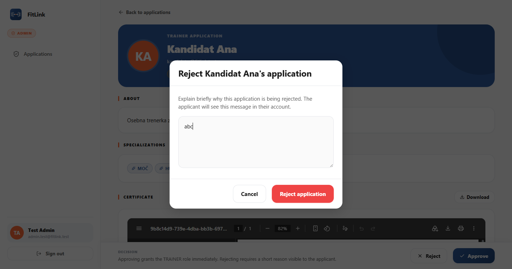
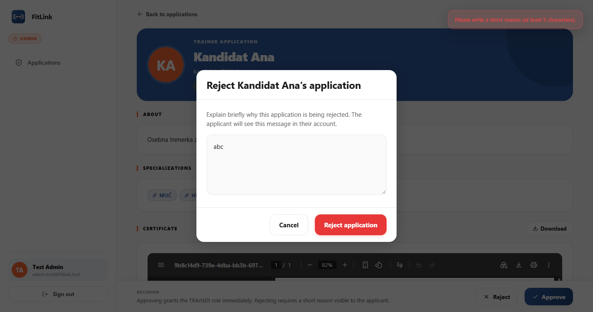
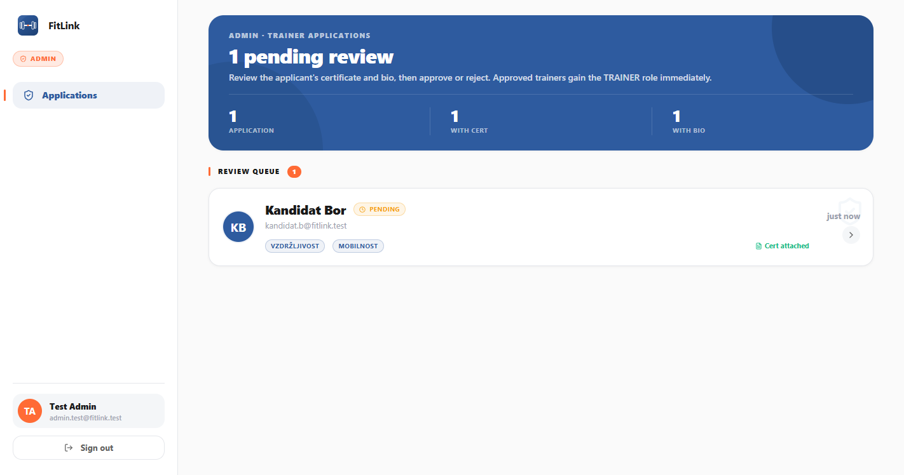

# Avtomatizacija funkcionalnih testov – webapp

**Avtor:** Nino Gubič · **Datum:** 16. 11. 2026 · **Koda testov:** [`e2e/web/`](../e2e/web/)

## 1. Orodje

**WebdriverIO 10** (Mocha, TypeScript), brskalnik Chrome.

- Isti jezik kot webapp in mobile-app (TypeScript).
- Samodejno čakanje na elemente; gonilnik za Chrome si namesti sam.
- Isto orodje z dodatkom Appium kasneje pokrije tudi mobilno aplikacijo (`e2e/mobile/`, zaenkrat prazno).
- Teče brez grafičnega vmesnika (`--headless=new`), rezultat vrne kot JUnit XML.

## 2. Vključitev v cevovod

Opravilo `e2e-web` v [`.github/workflows/main-pipeline.yml`](../.github/workflows/main-pipeline.yml), ob vsakem pushu na `main`.

| Kaj potrebuje | Kako je zagotovljeno |
|---|---|
| Zaledje + testna baza | `docker compose up -d --build` (Spring Boot + MongoDB 7) |
| Zagnana aplikacija | `npm run dev` v `webapp/` (`localhost:5173`) |
| Brskalnik in gonilnik | Chrome na GitHub runnerju, chromedriver namesti WebdriverIO |
| Testni podatki | `scripts/seed-test-data/seed.mjs`, zažene se samodejno pred testi (`onPrepare`) |
| Skrivnosti | `FIREBASE_CREDENTIALS_JSON` (že obstaja), `VITE_FIREBASE_API_KEY` (nova) |

**Vrne:** status opravila (neuspel test = rdeč cevovod) in artefakt `e2e-web-report` – JUnit XML za vsak scenarij ter posnetek zaslona vsakega neuspelega koraka.

Lokalni zagon: `docker compose up -d --build`, `npm run dev` v `webapp/`, nato `npm run test:web` v `e2e/`.

## 3. Avtomatizirani scenariji

Vsi trije scenariji iz [Testni-scenariji-webapp.md](Testni-scenariji-webapp.md), korak za korakom (imena testov = oznake korakov K1–K8).

| Scenarij | Koraki | Skripta |
|---|---|---|
| [TS-01 Prijava in usmerjanje glede na vlogo](Testni-scenariji-webapp.md#ts-01-prijava-in-usmerjanje-glede-na-vlogo) | 7 | [`ts-01-prijava.spec.ts`](../e2e/web/specs/ts-01-prijava.spec.ts) |
| [TS-02 Obravnava prijave trenerja](Testni-scenariji-webapp.md#ts-02-obravnava-prijave-trenerja) | 7 | [`ts-02-prijava-trenerja.spec.ts`](../e2e/web/specs/ts-02-prijava-trenerja.spec.ts) |
| [TS-03 Ustvarjanje predloge treninga za stranko](Testni-scenariji-webapp.md#ts-03-ustvarjanje-predloge-treninga-za-stranko) | 8 | [`ts-03-predloga-treninga.spec.ts`](../e2e/web/specs/ts-03-predloga-treninga.spec.ts) |

## 4. Namerna napaka

| | |
|---|---|
| **Sprememba** | `webapp/src/pages/admin/AdminApplicationDetailPage.tsx`: najmanjša dolžina razloga zavrnitve `< 5` → `< 3` |
| **Pričakovano** | pade TS-02 K4 (razlog `abc` mora biti zavrnjen) |
| **Rezultat** | **napaka zaznana** – TS-02 K4 neuspešen: obvestilo *"Please write a short reason (at least 5 characters)."* se ne prikaže, prijava je zavrnjena z razlogom `abc` |
| **Po odpravi** | sprememba razveljavljena, ponovni zagon 22/22 uspešnih |

**1. Vnos** – razlog `abc` (3 znaki), tik pred klikom *Reject application*:

**2. Pričakovano (brez napake)** – obvestilo o prekratkem razlogu, okno ostane odprto, prijava ostane *PENDING*:

**3. Dejansko (z namerno napako)** – obvestila ni, prijava je zavrnjena, Kandidat Ana ni več na seznamu. Posnetek je test naredil sam ob neuspelem koraku:

## 5. Dnevnik izvedbe

| # | Čas (16. 11. 2026) | Stanje kode | TS-01 | TS-02 | TS-03 | Rezultat |
|---|---|---|---|---|---|---|
| 1 | 16:37 | nespremenjena | 7/7 | 7/7 | 8/8 | USPEŠNO (22/22) |
| 2 | 16:43 | z namerno napako | 7/7 | 3/7 – K4 neuspešen, K5–K7 neizvedeni | 8/8 | NEUSPEŠNO |
| 3 | 16:55 | napaka odpravljena | 7/7 | 7/7 | 8/8 | USPEŠNO (22/22) |

## 6. Povzetek

- Avtomatiziranih je vseh 22 korakov treh scenarijev; celoten zagon traja približno 20 s (brez priprave okolja).
- Na nespremenjeni kodi so vsi testi uspešni, enako kot pri ročni izvedbi.
- Namerno vneseno napako je skripta zaznala v pravem koraku.
- Testi uporabljajo pravi razvojni Firebase projekt, zato v cevovodu teče samo en zagon naenkrat.
