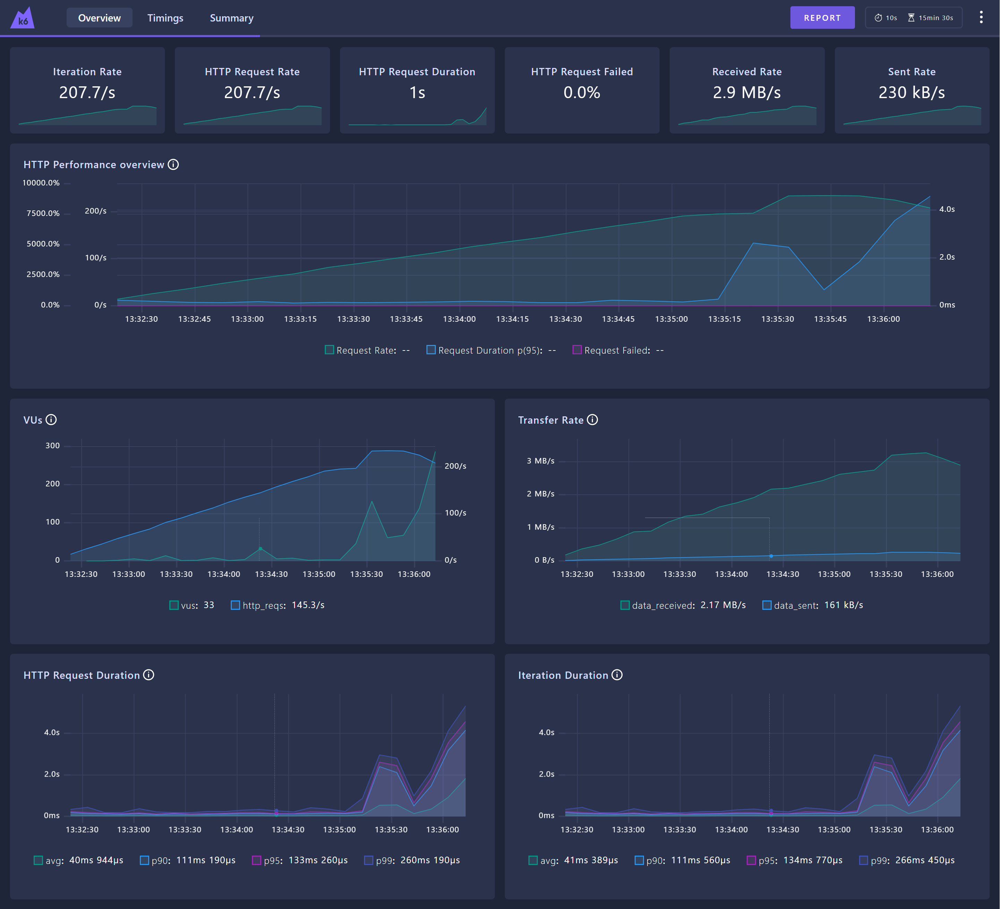
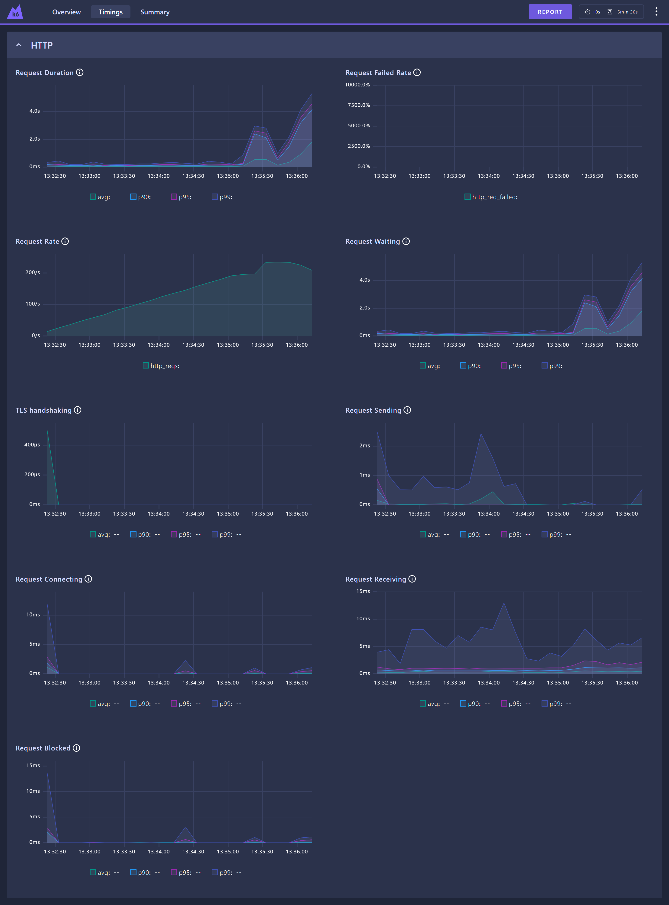
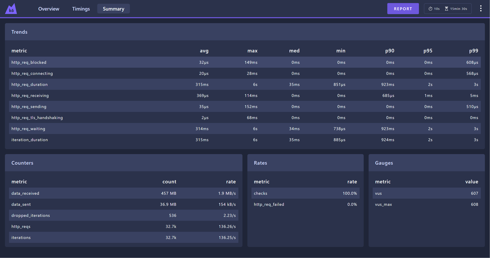

# Sistemsko testiranje – stresni test zaledja FitLink

**Projekt:** FitLink – REST API zaledja (`backend/`)
**Vrsta testiranja:** sistemsko, stresno testiranje (*breakpoint test*)
**Orodje:** Grafana k6 v2.2.0
**Avtor:** Nino Gubič
**Verzija dokumenta:** 1.0 (načrt, izvedba in rezultati, 26. 10. 2026)

---

## Kazalo

1. [Uvod](#1-uvod)
2. [Izbira orodja](#2-izbira-orodja)
3. [Analiza sistema pred testiranjem](#3-analiza-sistema-pred-testiranjem)
4. [Testno okolje](#4-testno-okolje)
5. [Testni podatki](#5-testni-podatki)
6. [Zasnova testa](#6-zasnova-testa)
7. [Postopek izvedbe](#7-postopek-izvedbe)
8. [Rezultati](#8-rezultati)
9. [Zaključek](#9-zaključek)

---

## 1. Uvod

### 1.1 Namen

Dokument opisuje stresno testiranje zaledja aplikacije FitLink: cilje, izbrano orodje, testno okolje, pripravo podatkov, scenarij, merjene metrike in kriterije uspešnosti ter rezultate izvedbe.

Stresni test postopoma povečuje obremenitev nad pričakovano raven uporabe, dokler sistem ne preneha delovati sprejemljivo. Za razliko od obremenitvenega testa (*load test*), ki preverja delovanje pri pričakovani obremenitvi, je cilj stresnega testa najti mejo zmogljivosti in opazovati, kako se sistem obnaša, ko jo preseže.

### 1.2 Cilji

| # | Cilj | Kako ga preverim |
|---|---|---|
| C1 | **Določiti točko odpovedi** – število zahtevkov na sekundo, pri katerem sistem preneha izpolnjevati kriterije odzivnosti oziroma zanesljivosti | Linearno naraščajoča obremenitev, test se ustavi ob prekoračitvi kriterija odpovedi |
| C2 | **Določiti zgornjo mejo sprejemljivega delovanja** – največjo obremenitev, pri kateri sistem še izpolnjuje kriterij "ustreza" | Časovni potek p95 odzivnega časa in deleža napak |
| C3 | **Odkriti problematične endpointe** – kateri endpointi so najpočasnejši in kateri prvi odpovedo | Ločene metrike odzivnega časa za vsak endpoint (oznaka `endpoint`) |
| C4 | **Odkriti ozko grlo** – katera komponenta (aplikacija ali podatkovna baza) prva doseže mejo virov | Vzporedno spremljanje CPU in pomnilnika kontejnerjev backend in MongoDB |
| C5 | **Opisati način odpovedi** – ali sistem odpove z napakami, z izgubo podatkov ali s počasnostjo | Delež napak, status kode, uspešnost zapisov (pošiljanje sporočil) |

### 1.3 Obseg

**V obsegu:** REST API zaledja (`/api/**`) z avtentikacijo prek Firebase ID tokena: klepet (seznam pogovorov, sporočila, pošiljanje), knjižnica vaj, vadbe in predloge varovancev, sodelovanja ter podatki o prijavljenem uporabniku.

**Izven obsega:**
- **WebSocket/STOMP** (klepet v realnem času).
- **Nalaganje datotek** (avatar, priponke, PDF, certifikati). S temi zahtevki bi meril predvsem disk in omrežje.
- **Registracija.** Ustvarja prave Firebase račune.
- **Video klici in administracija prijav trenerjev.** Redko se uporabljajo in vključujejo zunanje storitve.
- **Push obvestila (FCM).** Med testom so namenoma izklopljena (glej [3.4](#34-push-obvestila-fcm)).
- **Spletni odjemalec in mobilna aplikacija.**

### 1.4 Reference

- Grafana k6 dokumentacija – *Ramping arrival rate*, *Thresholds*, *Web dashboard* (grafana.com/docs/k6)
- `scripts/stress-test/README.md` – navodila za zagon testa
- `scripts/seed-test-data/seed-stress.mjs` – priprava testnih podatkov
- `docs/Testni-scenariji-webapp.md` – funkcionalno testiranje spletne aplikacije

---

## 2. Izbira orodja

Izbrano orodje je **Grafana k6**: odprtokodno orodje za obremenitveno testiranje, v katerem testne scenarije pišem v JavaScriptu.

| Kriterij | k6 |
|---|---|
| Model obremenitve | Podpira **odprti model** (*open model*, executor `ramping-arrival-rate`): zahtevki se pošiljajo s predpisanim tempom ne glede na odzivnost sistema. Zaprti model, ki samo dodaja uporabnike, se upočasni skupaj s sistemom in točko odpovedi zabriše |
| Kriteriji kot koda | `thresholds` z `abortOnFail`: kriterij odpovedi je zapisan v skripti, test se ob prekoračitvi sam ustavi |
| Metrike po endpointih | Oznake (*tags*) na zahtevkih omogočajo ločene metrike za vsak endpoint |
| Poročila | Povzetek v konzoli, izvoz v JSON (`--summary-export`), interaktivna nadzorna plošča z grafi skozi čas in HTML izvoz (`K6_WEB_DASHBOARD`) |
| Poraba virov | Napisan v Go; en proces ustvari več tisoč zahtevkov na sekundo, zato generator obremenitve ne postane ozko grlo |
| Ponovljivost | Skripta je v repozitoriju, vse nastavitve so podane z okoljskimi spremenljivkami |

**Upoštevane alternative:**
- **Apache JMeter** – grafični vmesnik in večja poraba virov, scenariji v XML so težje berljivi in jih je težje verzionirati.
- **Gatling** – primerljive zmožnosti, a scenariji v Scali/Javi, zato je prototipiranje počasnejše.
- **Locust** – scenariji v Pythonu, vendar pri visokih RPS na enem računalniku hitreje porabi CPU.

---

## 3. Analiza sistema pred testiranjem

Pred zasnovo testa sem pregledal kontrolerje in storitve zaledja. Želel sem ugotoviti, kateri endpointi se uporabljajo najpogosteje in kateri so najdražji. Ugotovitve so podlaga za izbiro endpointov in njihovih uteži v scenariju, hkrati pa so hipoteze, ki jih test preveri.

### 3.1 Arhitektura

- **Backend:** Java 21, Spring Boot 4.0.6, vgrajeni Tomcat (privzeto 200 delovnih niti).
- **Podatkovna baza:** MongoDB 7 (privzeti bazen povezav gonilnika: 100).
- **Avtentikacija:** vsak zahtevek nosi Firebase ID token.

### 3.2 Pot vsakega zahtevka

`FirebaseAuthFilter` za vsak zahtevek z avtentikacijo:
1. preveri podpis tokena (`verifyIdToken`). To se zgodi lokalno, z Googlovimi javnimi ključi v predpomnilniku, zato Firebase ni obremenjen;
2. vlogo uporabnika prebere iz MongoDB (`findByFirebaseUid`).

Vsak zahtevek torej že pred kontrolerjem izvede vsaj eno poizvedbo v bazo.

### 3.3 Hipoteze o problematičnih delih

| # | Ugotovitev | Lokacija | Pričakovan vpliv |
|---|---|---|---|
| H1 | **Problem N+1 pri seznamu pogovorov.** Za vsak pogovor se posebej izvedejo štetje neprebranih sporočil, branje udeležencev, iskanje vsakega udeleženca (do 2 poizvedbi) in branje sodelovanja. Pri 20 pogovorih je to **okoli 100 poizvedb za en HTTP zahtevek** | `ChatController.myConversations`, `ChatService.unreadCounts`, `ChatController.toConversationDto` | Najpočasnejši endpoint, verjetno prvi odpove |
| H2 | **MongoDB nima indeksov.** Entitete imajo indekse definirane z `@CompoundIndex`/`@Indexed`, vendar jih Spring ne ustvari, ker `spring.data.mongodb.auto-index-creation` ni vklopljen. V bazi obstajajo samo indeksi `_id`. Vse poizvedbe po `firebaseUid`, `conversationId`, `userId` in `ownerId` preiščejo celo zbirko | `application.properties`, preverjeno z `db.<zbirka>.getIndexes()` | Poraba CPU v MongoDB raste s številom dokumentov; ozko grlo bo verjetno baza |
| H3 | **Iskanje vaj z regularnim izrazom brez upoštevanja velikosti črk** (`regex(..., "i")`) ne more uporabiti indeksa | `ExerciseService.search` | Preiskovanje 873 vaj ob vsakem iskanju |
| H4 | **`/exercises/facets` ob vsakem klicu izvede 3 poizvedbe `distinct`**, brez predpomnjenja | `ExerciseController.facets` | Nepotrebna obremenitev baze za podatke, ki se ne spreminjajo |

### 3.4 Push obvestila (FCM)

Pošiljanje sporočila (`POST /chat/conversations/{id}/messages`) objavi dogodek, ki asinhrono (`@Async`) za vsakega prejemnika pokliče Firebase Cloud Messaging. Če bi bil FCM med testom vklopljen:
- bi vsako sporočilo sprožilo HTTPS klic na Googlove strežnike, zato bi delno meril njihovo odzivnost in svoje omrežje;
- bi vsa obvestila prejela ena sama naprava, kar hitro sproži FCM omejitev na napravo;
- bi se zaradi privzetega bazena za `@Async` (8 niti, neomejena vrsta) naloge nabirale v pomnilniku, česar odzivni čas HTTP zahtevka ne bi pokazal.

**Zato je FCM med testom izklopljen.** Noben testni uporabnik nima shranjenega push tokena, zato `FcmPushService` klic preskoči po eni poizvedbi v bazo. Za to ni potrebna nobena sprememba kode.

---

## 4. Testno okolje

| Komponenta | Specifikacija |
|---|---|
| Računalnik | Intel Core Ultra 5 226V (8 logičnih jeder), 15,6 GB RAM |
| Operacijski sistem | Windows 11 Home |
| Docker | Docker Desktop (Engine 29.9.2), WSL 2; na voljo 8 CPU in 7,5 GiB RAM |
| Backend | kontejner `fitlink-backend-1` (Spring Boot 4.0.6, Java 21), privzete nastavitve JVM in Tomcata |
| Podatkovna baza | kontejner `fitlink-mongodb-1` (`mongo:7`), privzete nastavitve, brez replikacije |
| Generator obremenitve | k6 v2.2.0, isti računalnik, zahtevki na `http://localhost:8080` |
| Spremljanje virov | `docker stats` vsake 2 s (`scripts/stress-test/monitor.sh`) |

**Omejitev okolja:** generator obremenitve (k6), backend in podatkovna baza tečejo na istem računalniku in si delijo CPU. Absolutne vrednosti (zahtevki na sekundo) zato veljajo samo za to okolje in niso ocena zmogljivosti produkcijskega strežnika. Relativne ugotovitve (kateri endpoint je najpočasnejši, katera komponenta je ozko grlo) ostanejo veljavne.

---

## 5. Testni podatki

### 5.1 Zakaj so potrebni realistični podatki

Odzivni čas več endpointov je odvisen od količine podatkov. Primer: če bi imel testni uporabnik en sam pogovor, se N+1 (H1) ne bi pokazal, brez indeksov (H2) pa bi bile prazne zbirke umetno hitre. Testni podatki zato posnemajo aktivnega trenerja z več treniranci.

### 5.2 Skripta za pripravo podatkov

Podatke pripravi skripta `scripts/seed-test-data/seed-stress.mjs` (Node.js, `firebase-admin`, `mongodb`). Zagon:

```bash
cd scripts/seed-test-data
npm install            # samo prvič
npm run seed:stress
```

Skripta po korakih:

1. **Preveri predpogoje.** Backend se mora odzivati na `/actuator/health`, MongoDB mora biti dosegljiv, v bazi mora biti knjižnica vaj (backend jo naloži ob zagonu).
2. **Pripravi Firebase račun trenerja** `stres.trener@fitlink.test`: ustvari ga ali posodobi, geslo nastavi na znano vrednost in odstrani custom claime. Brez claima backend vlogo bere iz MongoDB, tako kot pri pravih uporabnikih. To je edini račun, s katerim se k6 prijavi.
3. **Zapiše trenerja v MongoDB** (vloga `TRAINER`, odobren profil trenerja) in **odstrani morebitne push tokene** (`fcmToken`, `expoPushToken`).
4. **Pobriše podatke prejšnjega zagona:** pogovore trenerja z njihovimi sporočili, potrdili in udeleženci, ter sodelovanja, vadbe, predloge in uporabnike z oznako `stress-trainee-*`. Drugih podatkov v bazi ne spreminja.
5. **Za vsakega od 20 varovancev ustvari:**
   - uporabnika v MongoDB (brez Firebase računa, ker se varovanci med testom ne prijavljajo);
   - aktivno sodelovanje s trenerjem;
   - pogovor z dvema udeležencema;
   - 200 sporočil, ki si jih izmenjujeta varovanec in trener, razporejenih čez zadnjih 30 dni;
   - potrdilo o branju za vsako sporočilo, pri čemer je zadnjih 5 sporočil vsakega neprebranih (vpliva na štetje neprebranih v H1);
   - 30 opravljenih vadb s po 5 vajami in 3 serijami;
   - 3 predloge treninga.
6. **Preveri, da noben testni uporabnik nima push tokena.** Če ga ima, se skripta ustavi z napako, ker bi test sicer klical FCM.

Skripta je **idempotentna**: vsak zagon vzpostavi enako začetno stanje. Poženem jo pred vsako izvedbo testa, ker test sam dodaja sporočila.

### 5.3 Stanje baze po pripravi

| Zbirka | Dokumentov |
|---|---|
| `users` | 26 (trener, 20 varovancev, 5 računov funkcionalnih testov) |
| `coachings` | 21 |
| `conversations` | 20 |
| `conversationParticipants` | 40 |
| `messages` | 4.000 |
| `messageReceipts` | 4.000 |
| `workoutSessions` | 600 |
| `workoutTemplates` | 61 |
| `exercises` | 873 |

Količine se nastavijo z okoljskimi spremenljivkami (`STRESS_TRAINEES`, `STRESS_MESSAGES_PER_CONV`, `STRESS_SESSIONS_PER_TRAINEE` …).

---

## 6. Zasnova testa

### 6.1 Scenarij

Simulira se trener, ki uporablja aplikacijo: odpira seznam pogovorov in posamezne pogovore, pregleduje vadbe in predloge svojih varovancev, išče vaje in pošilja sporočila. Ob vsaki iteraciji k6 naključno izbere en zahtevek po spodnjih utežeh.

| Utež | Zahtevek | Oznaka | Utemeljitev |
|---|---|---|---|
| 25 % | `GET /api/chat/conversations` | `conversations` | Najpogosteje odprt zaslon; hipoteza H1 |
| 20 % | `GET /api/chat/conversations/{id}/messages?limit=50` | `messages` | Ob vsakem odprtju pogovora |
| 15 % | `GET /api/auth/me` | `auth_me` | Ob vsakem zagonu aplikacije in prijavi; izhodiščna meritev (najlažji endpoint) |
| 10 % | `GET /api/workouts/sessions/trainee/{id}` | `trainee_sessions` | Trener pregleduje vadbe varovanca |
| 5 % | `GET /api/workouts/templates/trainee/{id}` | `trainee_templates` | Trener pregleduje predloge varovanca |
| 10 % | `GET /api/exercises?q={izraz}` | `exercise_search` | Iskanje vaj pri sestavljanju treninga; H3 |
| 5 % | `GET /api/exercises/facets` | `exercise_facets` | Ob odprtju knjižnice vaj; H4 |
| 5 % | `GET /api/coaching/active` | `coaching_active` | Seznam aktivnih varovancev na nadzorni plošči |
| 5 % | `POST /api/chat/conversations/{id}/messages` | `send_message` | Glavna pisalna operacija (zapis sporočila, potrdil in posodobitev pogovora) |

ID pogovora, ID varovanca in iskalni izraz (`press`, `squat`, `curl` …) se za vsak zahtevek izberejo naključno.

### 6.2 Avtentikacija

V fazi `setup()` se k6 **enkrat** prijavi prek Firebase REST API (`accounts:signInWithPassword`) in pridobi ID token, ki ga nato uporabljajo vsi navidezni uporabniki. Tako med testom ne obremenjujem Firebase prijave, ki ima omejitve števila klicev in ni del sistema pod testom. Token velja 1 uro, zato test traja manj kot to. V isti fazi preverim, da ima uporabnik vlogo `TRAINER`, in preberem seznam pogovorov in varovancev.

### 6.3 Profil obremenitve

| Parameter | Vrednost |
|---|---|
| Executor | `ramping-arrival-rate` (odprti model) |
| Začetna obremenitev | 10 zahtevkov/s |
| Končna obremenitev | 1.000 zahtevkov/s |
| Naraščanje | linearno, 15 minut (≈ +1,1 zahtevka/s vsako sekundo) |
| Navidezni uporabniki (VU) | 100 vnaprej ustvarjenih, največ 2.000 |
| Časovna omejitev zahtevka | 10 s (daljši zahtevek šteje kot napaka) |
| Predčasna ustavitev | ob prekoračitvi kriterija odpovedi (6.5), z zamikom ocenjevanja 30 s |

Končna vrednost 1.000 zahtevkov/s je namenoma previsoka, ker naj bi sistem odpovedal že prej. Test se konča ob odpovedi, ne ob dosegu cilja.

Pred stresnim testom se izvede še **kratka preverba** (`PROFILE=smoke`: 5 zahtevkov/s, 30 s). Z njo preverim, da vsi endpointi vračajo pričakovane status kode.

### 6.4 Merjene metrike

**Na strani odjemalca (k6):**

| Metrika | Pomen |
|---|---|
| `http_req_duration` (mediana, p90, p95, p99, max) | Odzivni čas, skupno in za vsak endpoint posebej |
| `http_req_failed` | Delež neuspešnih zahtevkov (status ≥ 400 ali timeout) |
| `http_reqs` | Dosežen pretok (zahtevki/s) |
| `checks` | Ujemanje status kode s pričakovano (200 oz. 201) |
| `dropped_iterations` | Zahtevki, ki jih k6 ni mogel poslati, ker so bili vsi VU zasedeni s čakanjem na odgovor. Znak, da sistem ne dohaja obremenitve |
| `vus` | Število sočasno aktivnih VU; z Littlovim zakonom (VU / RPS) oceni povprečni čas v sistemu |

**Na strani strežnika (`docker stats`):**

| Metrika | Pomen |
|---|---|
| CPU % kontejnerja backend | Obremenjenost aplikacije (100 % = eno jedro, največ 800 %) |
| CPU % kontejnerja MongoDB | Obremenjenost podatkovne baze |
| Pomnilnik obeh kontejnerjev | Nabiranje čakajočih zahtevkov, morebitno uhajanje pomnilnika |

### 6.5 Kriteriji

| Kriterij | Pogoj | Vloga |
|---|---|---|
| **Sistem ustreza** | p95 odzivnega časa < 500 ms **in** delež napak < 1 % | Zgornja meja sprejemljivega delovanja (cilj C2); ocenjuje se tudi za vsak endpoint posebej |
| **Točka odpovedi** | p95 odzivnega časa > 2 s **ali** delež napak > 5 % | Test se samodejno ustavi (`abortOnFail`); obremenitev v tem trenutku je točka odpovedi (cilj C1) |

Meji 500 ms in 2 s izhajata iz uporabniške izkušnje mobilne aplikacije. Do pol sekunde uporabnik zamika skoraj ne opazi. Pri več kot 2 sekundah za odprtje zaslona, kot je seznam pogovorov, aplikacija deluje "zamrznjeno".

**Opomba o vrednotenju:** k6 kriterije vrednoti kumulativno, od začetka testa. Ker obremenitev narašča, se test ustavi nekoliko za dejansko točko odpovedi. Natančno točko zato odčitam iz časovnega grafa p95 in deleža napak na nadzorni plošči k6, ne samo iz trenutka ustavitve.

---

## 7. Postopek izvedbe

| Korak | Ukaz | Namen |
|---|---|---|
| 1 | `docker compose up -d` (korenska mapa) | Zagon backenda in MongoDB |
| 2 | `cd scripts/seed-test-data && npm run seed:stress` | Ponastavitev testnih podatkov (poglavje 5) |
| 3 | `cd scripts/stress-test && ./monitor.sh` (ločen terminal) | Beleženje CPU in pomnilnika v `results/docker-stats.csv` |
| 4 | `k6 run -e PROFILE=smoke stress.js` | Kratka preverba delovanja |
| 5 | Ponovno korak 2 | Odstrani sporočila, ki jih je dodala preverba |
| 6 | `K6_WEB_DASHBOARD=true K6_WEB_DASHBOARD_EXPORT=results/dashboard.html k6 run --summary-export=results/summary.json stress.js` | Stresni test |
| 7 | Ustavitev `monitor.sh` (Ctrl+C) | Konec beleženja |

Rezultati izvedbe:

| Datoteka | Vsebina |
|---|---|
| `results/summary.json` | Končne vrednosti metrik po endpointih |
| `results/dashboard.html` | Grafi metrik skozi čas (RPS, odzivni časi, napake, VU) |
| `results/docker-stats.csv` | Poraba CPU in pomnilnika kontejnerjev skozi čas |

---

## 8. Rezultati

### 8.1 Dnevnik izvedbe

| Izvedba | Čas | Trajanje | Ustavitev pri | Zahtevkov | Napak | Opomba |
|---|---|---|---|---|---|---|
| Preverba (`smoke`) | 26. 10. 2026 | 30 s | – (izvedena v celoti) | 154 | 0 | Vsi endpointi vrnejo pričakovano status kodo |
| Izvedba 1 | 26. 10. 2026, 12:34:58 | 4 min 24 s | ≈ 300 zahtevkov/s | 39.226 | 0 | Brez izvoza nadzorne plošče; rezultati samo iz končnega povzetka in `docker stats` |
| **Izvedba 2** | 26. 10. 2026, 13:32:13 | 4 min 00 s | ≈ 270 zahtevkov/s | 32.713 | 0 | **Referenčna izvedba**: časovni potek iz `results/dashboard.html` |

V obeh izvedbah je k6 test ustavil zaradi kriterija odpovedi `p(95)<2000` (`abortOnFail`). Kriterij `rate<0.05` za napake ni bil nikoli prekršen. Izvedbi se ujemata v točki nasičenja, problematičnem endpointu in ozkem grlu. V nadaljevanju so podrobno prikazani rezultati izvedbe 2, ker zanjo obstaja časovni potek metrik.

### 8.2 Točka odpovedi in meja sprejemljivega delovanja (C1, C2)

Časovni potek izvedbe 2 v intervalih po 10 s (vir: `results/dashboard.html`). *Ciljni* RPS je obremenitev, ki jo k6 poskuša ustvariti. *Dosežen* RPS je število zahtevkov, ki jih je sistem dejansko obdelal.

| t [s] | Ciljni RPS | Dosežen RPS | Mediana [ms] | p95 [ms] | p99 [ms] | Max [ms] | Napake | VU | Izpuščeni |
|---|---|---|---|---|---|---|---|---|---|
| 10 | 16 | 14 | 22 | 231 | 333 | 436 | 0 % | 0 | 0 |
| 20 | 27 | 26 | 12 | 183 | 431 | 507 | 0 % | 0 | 0 |
| 30 | 38 | 36 | 10 | 149 | 182 | 218 | 0 % | 2 | 0 |
| 40 | 49 | 48 | 9 | 133 | 180 | 265 | 0 % | 5 | 0 |
| 50 | 60 | 59 | 11 | 170 | 369 | 510 | 0 % | 1 | 0 |
| 60 | 71 | 68 | 8 | 116 | 216 | 353 | 0 % | 14 | 0 |
| 70 | 82 | 82 | 12 | 143 | 183 | 251 | 0 % | 1 | 0 |
| 80 | 93 | 91 | 8 | 123 | 178 | 218 | 0 % | 2 | 0 |
| 90 | 104 | 102 | 11 | 140 | 230 | 351 | 0 % | 8 | 0 |
| 100 | 115 | 113 | 15 | 158 | 229 | 298 | 0 % | 1 | 0 |
| 110 | 126 | 125 | 13 | 186 | 303 | 388 | 0 % | 4 | 0 |
| 120 | 137 | 136 | 16 | 180 | 343 | 516 | 0 % | 33 | 0 |
| 130 | 148 | 145 | 12 | 133 | 260 | 413 | 0 % | 5 | 0 |
| 140 | 159 | 158 | 9 | 131 | 210 | 317 | 0 % | 7 | 0 |
| 150 | 170 | 169 | 10 | 224 | 423 | 551 | 0 % | 2 | 0 |
| 160 | 181 | 179 | 11 | 200 | 352 | 537 | 0 % | 3 | 0 |
| 170 | 192 | 191 | 9 | 162 | 237 | 302 | 0 % | 3 | 0 |
| 180 | 203 | 196 | 13 | 276 | 868 | 994 | 0 % | 45 | 0 |
| **190** | **214** | **197** | **91** | **2.619** | **2.970** | **3.797** | 0 % | **156** | **70** |
| 200 | 225 | 234 | 72 | 2.444 | 2.808 | 3.435 | 0 % | 61 | 9 |
| 210 | 236 | 235 | 22 | 659 | 990 | 1.162 | 0 % | 67 | 0 |
| 220 | 247 | 234 | 57 | 1.833 | 2.189 | 2.663 | 0 % | 138 | 0 |
| 230 | 258 | 225 | 321 | 3.556 | 4.124 | 4.752 | 0 % | 287 | 146 |
| 240 | 269 | 208 | 1.370 | 4.566 | 5.316 | 6.360 | 0 % | 579 | 310 |



*Slika 1: Nadzorna plošča k6, pregled izvedbe 2.*
- *Zgoraj:* pretok zahtevkov (zeleno) enakomerno narašča do ≈ 13:35:15, nato se ustavi in proti koncu pade. p95 odzivnega časa (modro) je do tedaj blizu 0, nato pa strmo naraste in niha. Delež napak (vijolično) je ves čas 0 %.
- *Sredina levo:* število aktivnih VU naraste hkrati s skokom odzivnega časa, ker zahtevki čakajo na odgovor.
- *Spodaj:* odzivni časi (povprečje, p90, p95, p99). Po 13:35:15 se razmaknejo in dosežejo več sekund.

**Faze delovanja:**

1. **Stabilno delovanje (0–170 s, do ≈ 190 zahtevkov/s).**
   - Dosežen RPS sledi ciljnemu, mediana ostaja 8–16 ms, p95 pa 116–224 ms.
   - Hkrati aktivnih je le nekaj VU, kar pomeni, da se zahtevki ne nabirajo v vrsti.
   - p95 v tej fazi ne raste z obremenitvijo, ampak ga določa najpočasnejši endpoint, seznam pogovorov (8.3). Ta predstavlja 25 % vseh zahtevkov.
2. **Prvi znaki preobremenitve (180 s, ≈ 200 zahtevkov/s).**
   - Dosežen RPS (196) prvič opazno zaostaja za ciljnim (203).
   - p99 se poveča s 237 na 868 ms, število VU s 3 na 45.
3. **Odpoved (190 s, ciljnih ≈ 214 zahtevkov/s).**
   - p95 skoči s 276 ms na **2,6 s**, mediana z 13 na 91 ms.
   - Sistem obdela le 197 zahtevkov/s, k6 pa prvič izpusti zahtevke (70).
4. **Preobremenjenost (200–240 s).**
   - Odzivni časi nihajo. V intervalu 210 s si sistem delno opomore (p95 659 ms), ko obdela nakopičeno vrsto. Nato se zahtevki znova nabirajo.
   - **Dosežen RPS kljub naraščajoči obremenitvi pada** (235 → 208). Sistem porabi vedno več časa za upravljanje čakajočih zahtevkov in obdela vedno manj dela.
   - Ob ustavitvi čaka 579 VU, mediana znaša 1,4 s, p95 pa 4,6 s.

**Odgovor na cilja C1 in C2:**

| | Vrednost |
|---|---|
| **Meja sprejemljivega delovanja** (p95 < 500 ms, napake < 1 %) | **≈ 190–200 zahtevkov/s** (zadnji interval, ki izpolnjuje kriterij: 180 s, 196 zahtevkov/s, p95 276 ms) |
| **Točka odpovedi** (p95 > 2 s) | **≈ 200–215 zahtevkov/s** (prvi interval, ki prekrši kriterij: 190 s, ciljnih 214, doseženih 197 zahtevkov/s, p95 2,6 s) |
| Največji dosežen pretok | ≈ 235 zahtevkov/s (kratkotrajno, ob nestabilnih odzivnih časih) |
| Ustavitev testa (kumulativni p95 > 2 s) | 240 s, ciljnih ≈ 270 zahtevkov/s |

Med točko odpovedi (190 s) in ustavitvijo testa (240 s) je 50 s zamika. To je posledica kumulativnega vrednotenja kriterija (6.5): kumulativni p95 preseže 2 s šele, ko je dovolj počasnih zahtevkov v celotnem testu. Izvedba 1 je bila ustavljena pri ≈ 300 zahtevkih/s iz enakega razloga. Njeno nasičenje CPU (8.4) se je začelo pri ≈ 230 zahtevkih/s, kar se ujema z izvedbo 2.

### 8.3 Rezultati po endpointih (C3)

Kumulativne vrednosti za celotno izvedbo 2 (vir: `results/summary.json`):

| Endpoint | Zahtevkov | Mediana [ms] | p90 [ms] | p95 [ms] | p99 [ms] | Max [ms] | p95 < 500 ms |
|---|---|---|---|---|---|---|---|
| **`GET /chat/conversations`** | 7.993 | **171,6** | **2.993** | **3.724** | **4.741** | **6.360** | ✗ |
| `POST /chat/conversations/{id}/messages` | 1.646 | 26,6 | 427 | 901 | 1.841 | 2.231 | ✗ |
| `GET /exercises/facets` | 1.591 | 16,6 | 289 | 769 | 1.688 | 2.024 | ✗ |
| `GET /exercises?q=` | 3.322 | 16,5 | 262 | 738 | 1.629 | 2.152 | ✗ |
| `GET /workouts/sessions/trainee/{id}` | 3.309 | 16,0 | 279 | 737 | 1.693 | 2.091 | ✗ |
| `GET /chat/conversations/{id}/messages` | 6.577 | 17,2 | 292 | 711 | 1.638 | 2.232 | ✗ |
| `GET /workouts/templates/trainee/{id}` | 1.654 | 13,3 | 243 | 711 | 1.687 | 2.176 | ✗ |
| `GET /coaching/active` | 1.653 | 10,7 | 217 | 697 | 1.591 | 1.945 | ✗ |
| `GET /auth/me` | 4.965 | 9,9 | 210 | 639 | 1.552 | 1.842 | ✗ |
| **Skupaj** | 32.713 | 35,4 | 924 | 2.042 | 3.860 | 6.360 | ✗ |

Kumulativno vsi endpointi prekršijo kriterij p95 < 500 ms. Razlog je zadnjih 50 s preobremenjenosti, ko so bili počasni vsi zahtevki.

**Ugotovitve:**
- **Seznam pogovorov je izrazito najpočasnejši endpoint.**
  - Njegova mediana (172 ms) je 10- do 17-krat višja kot pri ostalih endpointih (10–27 ms), p95 (3,7 s) pa 4- do 6-krat višji.
  - Je edini endpoint, katerega najdaljši odzivni čas (6,4 s) občutno presega ostale (1,8–2,2 s).
  - Zahtevek, ki ga trener izvede najpogosteje (ob vsakem odprtju zaslona s pogovori), je hkrati najdražji. Ta endpoint s 25 % zahtevkov zato določa skupni p95.
- **Pošiljanje sporočila** je drugi najpočasnejši endpoint (mediana 27 ms, p95 0,9 s). Gre za edino pisalno operacijo: zapiše sporočilo, potrdilo o branju in posodobi pogovor.
- **Ostali endpointi so sami po sebi hitri** (mediana 10–17 ms), a so se pod obremenitvijo upočasnili skoraj enako kot vsi drugi. Vsi namreč tekmujejo za iste niti backenda in isti CPU podatkovne baze. **Zaradi enega dragega endpointa se upočasni celoten sistem**, tudi najlažji `GET /auth/me` (p95 0,64 s).

Enak vzorec je pokazala izvedba 1: seznam pogovorov je imel mediano 147 ms in p95 4,35 s, ostali endpointi pa mediano 5–17 ms in p95 1,3–1,9 s.

### 8.4 Poraba virov in ozko grlo (C4)

Poraba CPU kontejnerjev med izvedbo 2 (vir: `results/docker-stats.csv`; 100 % = eno jedro, na voljo 800 %):

| Čas | t [s] | ≈ Ciljni RPS | Backend CPU | MongoDB CPU | Skupaj | Backend RAM | MongoDB RAM |
|---|---|---|---|---|---|---|---|
| 13:32:33 | 20 | 27 | 66 % | 87 % | 153 % | 709 MiB | 173 MiB |
| 13:33:08 | 55 | 65 | 46 % | 89 % | 135 % | 710 MiB | 170 MiB |
| 13:33:44 | 91 | 105 | 90 % | 200 % | 290 % | 710 MiB | 166 MiB |
| 13:34:30 | 137 | 155 | 148 % | 321 % | 469 % | 708 MiB | 159 MiB |
| 13:35:05 | 172 | 194 | 149 % | 377 % | 526 % | 715 MiB | 157 MiB |
| **13:35:14** | **181** | **204** | **220 %** | **482 %** | **702 %** | 733 MiB | 171 MiB |
| 13:35:44 | 211 | 237 | 240 % | 515 % | 755 % | 745 MiB | 179 MiB |
| 13:36:11 | 238 | 268 | 227 % | 514 % | 741 % | 753 MiB | 180 MiB |
| 13:36:16 | konec | – | 0,5 % | 2,6 % | – | 752 MiB | 179 MiB |

**Ugotovitve:**
- **CPU je ozko grlo.**
  - Ob 13:35:14 (t ≈ 180 s, ≈ 200 zahtevkov/s) skupna poraba skoči na ≈ 700–750 % od 800 % in tam ostane do konca testa. Ostanek porabi generator obremenitve k6 na istem računalniku.
  - Trenutek nasičenja CPU se do 10 s natančno ujema s točko odpovedi iz 8.2.
  - Od tam naprej dodatna obremenitev ne more biti obdelana, zato se zahtevki nabirajo v vrsti.
- **Ozko grlo je podatkovna baza.**
  - MongoDB ves čas testa porabi približno **2-krat več CPU kot backend**, ob nasičenju ≈ 500 % proti ≈ 240 %.
  - Backend je pretežno aplikacija, ki čaka na odgovore baze: prejme zahtevek, pošlje poizvedbe in pretvori rezultat v JSON.
- **Pomnilnik ni omejitev.**
  - Backend se je povečal s 709 na 753 MiB (+44 MiB) zaradi čakajočih zahtevkov, MongoDB pa je ostal pod 181 MiB. Oba sta daleč pod 7,5 GiB, ki so na voljo.
  - V izvedbi 1, ki je trajala dlje, se je backend povečal na 740 MiB.
- **Okrevanje je takojšnje.** Že 3 s po ustavitvi obremenitve poraba CPU obeh kontejnerjev pade pod 3 %. Sistem ni ostal v okvarjenem stanju in ga ni bilo treba ponovno zagnati.

Izvedba 1 kaže enak vzorec: nasičenje pri ≈ 230 zahtevkih/s, MongoDB ≈ 500 %, backend ≈ 250 %.



*Slika 2: Razčlenitev časa HTTP zahtevkov.*

Celoten odzivni čas (*Request Duration*) se skoraj v celoti ujema s časom čakanja na odgovor strežnika (*Request Waiting*). Vzpostavljanje povezave (*Connecting*, *Blocked*), pošiljanje (*Sending*) in prejemanje (*Receiving*) ostanejo v območju nekaj milisekund tudi med preobremenitvijo. To potrjuje dvoje:
- zamik nastaja na strežniku (backend in baza), ne v omrežju;
- generator obremenitve k6 ni bil ozko grlo.

### 8.5 Način odpovedi (C5)

| Vidik | Rezultat |
|---|---|
| Napake HTTP (status ≥ 400, timeout 10 s) | **0 od 32.713** (izvedba 1: 0 od 39.226) |
| Preverbe status kode (`checks`) | 32.710 / 32.710 uspešnih (100 %) |
| Pisalne operacije | Vseh 1.646 pošiljanj sporočil je vrnilo `201 Created`. V bazi je po testu 1.665 sporočil z oznako k6 (vključno s sporočili iz preverbe), za vsako tudi potrdilo o branju. **Podatki se niso izgubili** |
| Napake v dnevniku backenda | Ena sama izjema `ClientAbortException: Broken pipe` ob 13:36:15. To je trenutek ustavitve testa, ko je k6 zaprl odprte povezave, zato ne gre za napako sistema |
| Najdaljši odzivni čas | 6,4 s (pod mejo timeouta 10 s) |
| Izpuščeni zahtevki (`dropped_iterations`) | 536 |



*Slika 3: Končni povzetek izvedbe 2: 32,7 tisoč zahtevkov, 100 % uspešnih preverb, 0 % napak, 536 izpuščenih iteracij, 607 VU ob ustavitvi.*

**Sistem pri preobremenitvi ne odpove z napakami, ampak s počasnostjo.**
- Tomcat sprejme vse zahtevke in jih postavi v vrsto. Vsi so na koncu pravilno obdelani, vendar z vse daljšim čakanjem.
- Z vidika podatkovne celovitosti je to dobro: ni napačnih odgovorov in ni izgubljenih zapisov.
- Z vidika uporabnika je odpoved kljub temu dejanska. Pri p95 4,6 s in mediani 1,4 s aplikacija deluje "zamrznjeno".
- Ker sistem nima omejevanja (*rate limiting*) niti zavračanja ob preobremenitvi (npr. `503 Service Unavailable`), ne odpove hitro in nadzorovano. Čakajoči zahtevki dodatno upočasnijo obdelavo vseh ostalih, zato se je dosežen pretok po točki odpovedi celo zmanjšal (8.2, faza 4).

### 8.6 Preverjanje hipotez H1–H4

| # | Hipoteza | Rezultat | Utemeljitev |
|---|---|---|---|
| H1 | N+1 pri seznamu pogovorov → najpočasnejši endpoint, prvi odpove | **Potrjena** | Mediana 172 ms proti 10–27 ms pri ostalih, p95 3,7 s, najdaljši odziv 6,4 s. Razlika je vidna že pri 5 zahtevkih/s v preverbi (p95 189 ms proti 10–44 ms) |
| H2 | Brez indeksov → ozko grlo je baza | **Potrjena posredno** | MongoDB porabi ves čas 2-krat več CPU kot backend in prvi doseže zasičenje. Test ne izolira vpliva indeksov od vpliva N+1, ker oba obremenjujeta bazo. Neposredna potrditev zahteva ponovitev testa z ustvarjenimi indeksi |
| H3 | Iskanje vaj z regexom je počasno | **Ni potrjena** | Mediana 16,5 ms in p95 738 ms, enako kot pri endpointih brez iskanja. Pri 873 vajah preiskovanje cele zbirke ni opazen strošek |
| H4 | `facets` (3 × `distinct`) nepotrebno obremenjuje bazo | **Ni potrjena** kot pomemben problem | Mediana 16,6 ms, p95 769 ms, primerljivo z ostalimi; endpoint ima le 5 % zahtevkov |

---

## 9. Zaključek

### 9.1 Povzetek

Stresni test je dosegel vse zastavljene cilje:

| Cilj | Rezultat |
|---|---|
| C1 – točka odpovedi | **≈ 200–215 zahtevkov/s**: p95 preseže 2 s, sistem ne dohaja več obremenitve |
| C2 – meja sprejemljivega delovanja | **≈ 190–200 zahtevkov/s** s p95 < 500 ms in 0 % napak |
| C3 – problematični endpointi | **`GET /api/chat/conversations`**: 10- do 17-krat počasnejši od ostalih in prevladujoči vir obremenitve; drugi je `POST .../messages` |
| C4 – ozko grlo | **CPU podatkovne baze MongoDB**: ves čas porabi 2-krat več CPU kot backend, nasičenje ob točki odpovedi |
| C5 – način odpovedi | **Počasnost brez napak**: 0 napak, brez izgube podatkov, takojšnje okrevanje. Sistem pa nima mehanizma za nadzorovano zavračanje zahtevkov, zato se po točki odpovedi pretok zmanjša |

**Ali sistem ustreza?** Z izbranimi kriteriji sistem ustreza do ≈ 190 zahtevkov/s. Koliko uporabnikov to pomeni, je odvisno od tega, koliko zahtevkov ustvari posamezen uporabnik. Spodnji izračun je informativen in temelji na predpostavkah o uporabi aplikacije, ne na meritvah prometa.

*Koliko zahtevkov ustvari en aktiven uporabnik.* Ob vsakem prehodu na nov zaslon aplikacija pošlje 1–3 zahtevke, na primer seznam pogovorov, sporočila pogovora ali vadbe varovanca. Pri aktivni uporabi uporabnik zamenja zaslon oziroma izvede dejanje (pošlje sporočilo, zabeleži serijo) približno vsakih 10–20 s. Ocenjujem torej:

| Vrsta uporabe | Zahtevkov na minuto | Zahtevkov na sekundo |
|---|---|---|
| Intenzivna (trener odgovarja varovancem, hitro preklaplja med zasloni) | ≈ 15 | 0,25 |
| **Običajna** (varovanec beleži vadbo, občasno pregleda klepet) | **≈ 10** | **≈ 0,17** |
| Pasivna (aplikacija odprta, uporabnik bere) | ≈ 2 | 0,03 |

*Število sočasno aktivnih uporabnikov.* Pri običajni uporabi zmore sistem:

190 zahtevkov/s × 60 s = 11.400 zahtevkov/min → 11.400 / 10 zahtevkov/min na uporabnika ≈ **1.100 sočasno aktivnih uporabnikov**

Pri intenzivni uporabi (15 zahtevkov/min) je to ≈ 760, pri pasivni pa več kot 5.000 sočasnih uporabnikov.

*Skupno število uporabnikov.* Vsi registrirani uporabniki niso aktivni hkrati. Pri aplikacijah za vadbo je v najbolj obremenjeni uri sočasno aktivnih običajno največ 10–20 % dnevnih uporabnikov, predvsem zvečer, ko varovanci telovadijo. Iz ≈ 1.100 sočasnih uporabnikov sledi, da sistem lahko podpira **≈ 5.000–11.000 dnevno aktivnih uporabnikov**.

| | Ocena |
|---|---|
| Sočasno aktivni uporabniki (običajna uporaba) | ≈ 1.100 |
| Dnevno aktivni uporabniki (10–20 % sočasnosti) | ≈ 5.000–11.000 |

**Sistem v trenutni obliki zadostuje za več kot 1.000 uporabnikov**, tudi ob upoštevanju precejšnje varnostne rezerve. Če bi bilo hkrati aktivnih vseh 1.000 uporabnikov, kar je zelo pesimističen scenarij, bi pri običajni uporabi ustvarili ≈ 170 zahtevkov/s, kar je še pod mejo sprejemljivega delovanja.

**Omejitve ocene:**
- Ocena velja za testne podatke, kjer ima trener 20 varovancev.
- Testni scenarij je obremenjen v korist trenerja (25 % zahtevkov je seznam pogovorov, najdražji endpoint). Varovanci ta zaslon odpirajo redkeje, zato je dejanska zmogljivost za mešano populacijo verjetno nekoliko višja.
- Ker se cena seznama pogovorov povečuje s številom pogovorov (N+1) in z velikostjo zbirk (brez indeksov), se bo meja ob rasti podatkov znižala. Pri več tisoč uporabnikih in nekaj sto tisoč sporočilih bi bila nižja od izmerjene, zato je priporočila 1 in 2 iz 9.2 smiselno izvesti, preden število uporabnikov doseže to raven.

### 9.2 Priporočila

Po pričakovanem učinku:

1. **Vklopiti ustvarjanje indeksov** (`spring.data.mongodb.auto-index-creation=true`) ali jih ustvariti ročno. Indeksi so v entitetah že definirani, zato je to sprememba ene vrstice in zmanjša strošek vseh poizvedb, ne le seznama pogovorov.
2. **Odpraviti N+1 v `GET /chat/conversations`:**
   - število neprebranih za vse pogovore pridobiti z eno agregacijo (`$group` po `conversationId`);
   - udeležence in uporabnike pridobiti z eno poizvedbo (`findByConversationIdIn`, `findByFirebaseUidIn`);
   - sodelovanja pridobiti z `findAllById`.

   Število poizvedb na zahtevek se tako zmanjša s ≈ 100 na ≈ 5, ne glede na število pogovorov.
3. **Dodati nadzorovano zavračanje ob preobremenitvi:** omejitev velikosti vrste in števila niti Tomcata ali omejevanje števila zahtevkov, da sistem ob preobremenitvi hitro vrne `503` ali `429`, namesto da upočasni vse uporabnike.
4. **Predpomniti `GET /exercises/facets`.** Gre za manjši prispevek, a so podatki statični.

Po spremembah 1 in 2 je smiselno test ponoviti z istim scenarijem in podatki ter primerjati točko odpovedi. To bi tudi neposredno potrdilo hipotezo H2.

### 9.3 Omejitve testa

- **Generator obremenitve, backend in baza tečejo na istem računalniku** (8 jeder). k6 porabi del CPU, ki bi ga sicer imel sistem pod testom. Absolutne vrednosti RPS zato veljajo le za to okolje, relativne ugotovitve (endpoint, komponenta, način odpovedi) pa so neodvisne od okolja.
- **En sam prijavljen uporabnik.** Vsi zahtevki uporabljajo isti token in istega trenerja. Pravi promet bi bil razpršen čez več uporabnikov in pogovorov, kar vpliva na predpomnjenje v MongoDB.
- **Pogoji brez FCM in WebSocket.** Push obvestila so bila izklopljena, povezave WebSocket pa niso bile odprte. V produkciji bi oba dodatno obremenila backend.
- **Kumulativno vrednotenje kriterijev v k6** zamakne ustavitev testa za dejansko točko odpovedi. Točka odpovedi je zato določena iz časovnega poteka v intervalih po 10 s, ne iz trenutka ustavitve.
- **Velikost testnih podatkov** (20 pogovorov, 4.000 sporočil) predstavlja enega aktivnega trenerja. Pri večji bazi bi bila točka odpovedi nižja.
